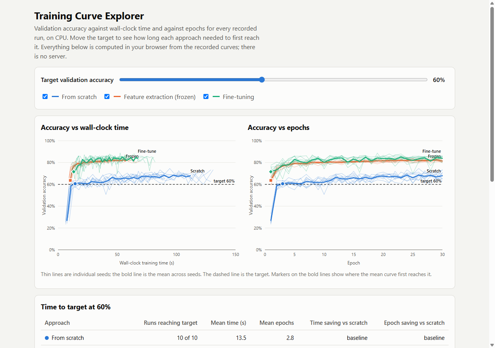
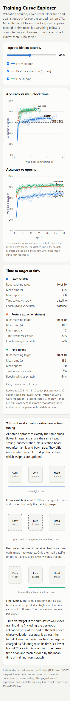
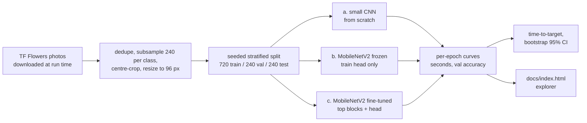

# Transfer Learning for Computer Vision: how much training time does it save?

[](https://creativecommons.org/licenses/by-nc-nd/4.0/)

## Overview

An independent, reproducible measurement of how much CPU training time transfer learning saves compared with training from scratch on a small flower-photo classification task. It reports time-to-target (seconds and epochs until validation accuracy first reaches a target) for a from-scratch CNN, a frozen pretrained MobileNetV2 and a fine-tuned MobileNetV2, over 10 seeds each, with bootstrap intervals and an interactive explorer of every recorded training curve.

**Independent experiment on public data. The 30% reduction in training time on the CV is a reported result from an earlier project and is not reproduced here.** The original project's data and code are not available, and nothing in this repository claims to be that result.

## Demo

Open `docs/index.html` in a browser (double-click it; no server, no network). Move the target-accuracy slider and the time-to-target table and the curves update live from the recorded runs. A "How it works" panel explains feature extraction versus fine-tuning. Local only; nothing is deployed.

| Desktop (1280 px) | Phone (390 px) |
|---|---|
|  |  |

## Problem statement

How much training time does transfer learning save compared with training from scratch, for the same target accuracy, on a small image-classification task on a CPU?

The metric is defined precisely:

- **Time-to-target**: the cumulative wall-clock training time (and the number of epochs) at the end of the first epoch whose validation accuracy is at least the target. The timer is monotonic and includes the per-epoch validation pass.
- **Relative reduction vs scratch**: `1 - mean(time-to-target of approach) / mean(time-to-target of scratch)`.
- **Final accuracy at a fixed budget**: validation and test accuracy after 30 epochs.
- A run that never reaches the target is charged its full budget, so its time is a lower bound (shown as `>=`).

## Approach



- **From scratch**: a 4-block CNN with batch norm (241,829 parameters, random initialisation).
- **Feature extraction (frozen)**: MobileNetV2 with ImageNet weights, backbone frozen, only the classification head trains (6,405 trainable parameters).
- **Fine-tuning**: the same backbone with the last blocks (from `block_13_expand`) also trained, batch-norm layers kept frozen (1,669,765 trainable parameters).
- **Identical for all three**: input scaling, augmentation (flip, small rotation and zoom), head, Adam optimiser, batch size 32, loss, 30-epoch budget, and seeds 0 to 9 for initialisation and shuffling.
- **One per-approach setting, disclosed**: the learning rate (scratch 3e-4, frozen 1e-3, fine-tune 3e-4). It was picked from {1e-3, 3e-4, 1e-4} on a separate pilot seed (100), because fine-tuning at 1e-3 collapses to chance accuracy. See `docs/runs/2026-10-14-experiment.md` for the full protocol, including the two choices made after looking at the pilot.
- **Timing**: `time.perf_counter()` around `model.fit` only. Dataset download and caching, model construction, ImageNet weight download and the final test evaluation are excluded. Graph tracing in epoch 1 is included for every approach.

## Data

| Item | Value |
|---|---|
| Source | TF Flowers, https://storage.googleapis.com/download.tensorflow.org/example_images/flower_photos.tgz (downloaded at run time into `data/`, never committed) |
| Licence | Photographs are CC BY 2.0 with per-photo attribution (see `THIRD_PARTY_NOTICES.md`) |
| Classes | 5: daisy, dandelion, roses, sunflowers, tulips |
| Subset | 3 exact-duplicate files removed from 3,670, then 240 photos per class (1,200 images), sampled with seed 2026 |
| Image size | centre-cropped square, resized to 96 x 96 |
| Split | stratified 60/20/20, seed 2026: 720 train, 240 validation, 240 test (144/48/48 per class), identical for every run |
| Leakage checks | split indices are disjoint (unit-tested) and no pixel-identical image appears in two splits (asserted when the cache is built) |
| Privacy | photographs of flowers; no personal data. `results/split_manifest.json` lists file names only |

## Results

Verified (run 2026-10-14, 10 seeds per approach, AMD Ryzen 7 5800X 8-core / 16 logical cores / 31.9 GB RAM, CPU only). Full tables for every target, the raw per-run CSV (`results/per_run.csv`), the per-epoch CSV (`results/per_epoch.csv`) and the run log (`docs/runs/2026-10-14-experiment.md`) are committed. Intervals are 95% percentile bootstrap over the 10 seeds.

**Primary target: 64.6% validation accuracy** (95% of what the from-scratch CNN reaches after 30 epochs, a target scratch can reach). All 30 runs reached it.

| Approach | Mean time-to-target (95% CI) | Mean epochs (95% CI) | Time reduction vs scratch (95% CI) | Epoch reduction vs scratch (95% CI) | Status |
|---|---|---|---|---|---|
| From scratch | 32.0 s (26.2 to 38.3) | 8.1 (6.5 to 9.8) | baseline | baseline | Verified |
| Feature extraction (frozen) | 11.4 s (10.3 to 12.7) | 1.6 (1.3 to 1.9) | **64%** (55 to 71%) | 80% (74 to 85%) | Verified |
| Fine-tuning | 13.3 s (11.9 to 14.7) | 1.0 (1.0 to 1.0) | **58%** (48 to 66%) | 88% (85 to 90%) | Verified |

The saving depends strongly on how demanding the target is:

| Target | Frozen: time reduction (95% CI) | Fine-tune: time reduction (95% CI) | Notes |
|---|---|---|---|
| 60% | 20% (8 to 31%) | 1% (-13 to 14%, not significant) | easy target: every run reaches it within a few epochs |
| 64.6% (primary) | 64% (55 to 71%) | 58% (48 to 66%) | |
| 70% | >= 87% (83 to 89%) | >= 84% (80 to 87%) | scratch reached it in only 9 of 10 runs, so these are lower bounds |
| 80% | >= 81% (78 to 84%) | >= 83% (80 to 85%) | scratch never reached it, lower bounds |

Final accuracy after the 30-epoch budget (Verified, same run):

| Approach | Validation accuracy (95% CI) | Test accuracy (95% CI) | Total training time (95% CI) |
|---|---|---|---|
| From scratch | 68.0% (65.7 to 70.4) | 68.0% (66.6 to 69.2) | 111.9 s (102.0 to 121.5) |
| Feature extraction (frozen) | 81.5% (80.9 to 82.1) | 80.3% (79.8 to 80.8) | 57.2 s (52.4 to 62.0) |
| Fine-tuning | 83.9% (82.3 to 85.3) | 82.8% (81.3 to 84.2) | 67.4 s (61.2 to 73.7) |

### What the numbers mean

- **Transfer learning saved a large fraction of training time here, and the saving grows with the target.** Against a from-scratch CNN, the pretrained backbones reached a moderate accuracy about 60% sooner and the higher targets (80%) at least 80% sooner. The scratch model never reached 80% validation accuracy in 30 epochs, whereas both pretrained approaches passed it in about 20 seconds.
- **At an easy target the saving was small or absent.** For a 60% target, fine-tuning saved 1% of the time (interval spans zero). The reason is a fixed cost: epoch 1 took 7.6 s for scratch, 10.4 s for frozen and 13.3 s for fine-tuning on average (graph tracing and first-batch setup), while in steady state a pretrained epoch is cheaper (about 1.6 s frozen, 1.9 s fine-tuned) than a scratch epoch (about 3.6 s). When the target is reached in one or two epochs, the start-up cost dominates and hides the per-epoch advantage. Per epoch, the saving is large at every target (epoch reductions of 57% to 94% across the targets up to 80%).
- **Why a frozen backbone is cheaper per epoch in this setup.** No gradient is computed for the backbone, and MobileNetV2 at 96 px is a small network; the scratch CNN here, although it has fewer parameters, spends more compute per image at full resolution in its early layers. This is a plausible explanation and was not isolated by a separate profiling experiment.
- **Fine-tuning versus feature extraction.** Fine-tuning ends more accurate (83.9% vs 81.5% validation) and reaches 80% in fewer epochs (4.1 vs 7.7) and slightly fewer seconds (the intervals overlap), but it costs more per epoch and needed a lower learning rate to train at all.
- **How this relates to the "30%" on the CV.** The reduction measured here is of the same kind ("how much less training time for the same accuracy") but it is a different task, dataset, model pair and metric definition, and it varies from about 1% to over 80% depending on the target. It must not be read as confirming, or being, the CV figure.

## Tech stack

Python 3.11, TensorFlow 2.21 / Keras 3 (CPU), NumPy, pandas, Pillow, pytest. The explorer is a single static HTML file with inline SVG and plain JavaScript (no libraries, no network).

## Getting started

Prerequisites: Python 3.11 (64-bit), about 1 GB free disk space (TensorFlow, the 229 MB image archive and the cache), internet access for the first run. No GPU needed.

```bash
git clone https://github.com/Janeferdinant/transfer-learning-vision.git
cd transfer-learning-vision
py -3.11 -m venv .venv                       # Windows; on Linux/macOS: python3.11 -m venv .venv
.venv\Scripts\activate                       # Windows; on Linux/macOS: source .venv/bin/activate
python -m pip install -r requirements.txt
python -m pytest -q                          # expected: 30 passed
python -m tlv.experiment --seeds 0 --epochs 3 --out results/smoke   # quick check, a few minutes
```

The smoke run downloads TF Flowers and the MobileNetV2 weights once, builds `data/flowers_96px_240pc_seed2026.npz`, trains the three approaches for 3 epochs and prints one line per run (`scratch seed=0 train=...s val=... test=...`). To reproduce the committed results (about 40 minutes on the machine above):

```bash
python -m tlv.experiment --seeds 0 1 2 3 4 5 6 7 8 9 --epochs 30   # writes results/per_run.csv and per_epoch.csv
python -m tlv.aggregate                                            # results/summary.json and summary.md
python -m tlv.export_viz --date <YYYY-MM-DD>                       # docs/curves.js for the explorer
```

Do not run other heavy programs while the experiment runs: it measures wall-clock time. The repository already contains the 2026-10-14 results, so running the experiment again will append to `results/*.csv`; use `--out` to write elsewhere. Timings from your machine will differ; the relative reductions are the comparable quantity.

## Project structure

```
tlv/metrics.py       time-to-target, censoring, bootstrap CI, relative reduction
tlv/timing.py        monotonic epoch timer (pause/resume, injectable clock)
tlv/data.py          download, de-duplication, seeded subsample and stratified split
tlv/models.py        the three approaches
tlv/experiment.py    training runner (resumable), writes per-epoch and per-run CSVs
tlv/aggregate.py     summaries with bootstrap intervals, markdown tables
tlv/export_viz.py    precomputes docs/curves.js for the explorer
tests/               pytest suite (30 tests, no TensorFlow needed)
results/             per_run.csv, per_epoch.csv, summary.json/.md, hardware.json, split_manifest.json
docs/index.html      static training-curve explorer (opens from disk)
docs/runs/           run log and pilot learning-rate sweep
```

## Real-world applications

- Deciding whether fine-tuning a pretrained backbone is worth it when compute, energy or turnaround time is limited, for example on a laptop or a small shared server.
- Teaching: a concrete, measured example of why pretrained features shorten training, and of how a "percent faster" claim depends on the accuracy target and on fixed start-up costs.
- A template for reporting training-efficiency claims honestly: define the metric, fix the protocol, repeat over seeds and report intervals.

## Limitations

- **One small task**: five flower classes, 1,200 photographs, 96 px images. Results may differ for other datasets, larger images or domains far from ImageNet.
- **One CPU, one desktop**: timings depend on the machine and on background load, which was not controlled (per-run times varied by roughly 10 to 20%). Relative reductions are more transferable than seconds.
- **The baseline is modest**: the scratch CNN reaches 68% validation accuracy. It was lightly tuned (three learning rates on one pilot seed). A stronger or longer-trained scratch model would narrow the gap.
- **Seed variance only**: seeds change initialisation, shuffling and augmentation, but the train/validation/test split is fixed. Ten seeds give wide-ish intervals for small effects.
- **Target definition matters**: the primary target is derived from the same runs, and the targets that scratch never reaches yield lower bounds rather than point estimates. The first epoch includes one-off graph tracing.
- **Pilot choices**: the learning rates, the 30-epoch budget and the batch-norm momentum of the scratch CNN were chosen after a single-seed pilot; they are disclosed in the run log.
- **Not the CV result**: the original project's data and code are unavailable; this experiment neither reproduces nor validates the 30% figure.

## Future scope

- Repeat on a second dataset (for example an Oxford-IIIT Pet subset) and at other image sizes.
- Vary the data split as well as the seed, and add a stronger scratch baseline with a proper learning-rate search.
- Add a larger backbone (for example ResNet50) to test whether the per-epoch advantage reverses.
- Profile where epoch time goes (tracing, input pipeline, forward, backward) to confirm the explanation above.

## Credits & citation

- Photographs: the TF Flowers dataset, CC BY 2.0, with thanks to the photographers listed in the archive's `LICENSE.txt`.
- Architecture: Sandler et al., "MobileNetV2: Inverted Residuals and Linear Bottlenecks", CVPR 2018. ImageNet-pretrained weights via `tf.keras.applications`.
- Full notices: `THIRD_PARTY_NOTICES.md`.

If you refer to this work: Ferdinant, J. R., "Transfer learning for computer vision: an independent time-to-target measurement" (GitHub repository, 2026).

## License

Original work © Jane Rose Ferdinant, licensed CC BY-NC-ND 4.0. Third-party components retain their own licenses; see THIRD_PARTY_NOTICES.md.

## Author

Jane Rose Ferdinant, Assistant Professor, AI & ML.

- Portfolio: https://janeferdinant.vercel.app
- LinkedIn: https://www.linkedin.com/in/janerosenf/
