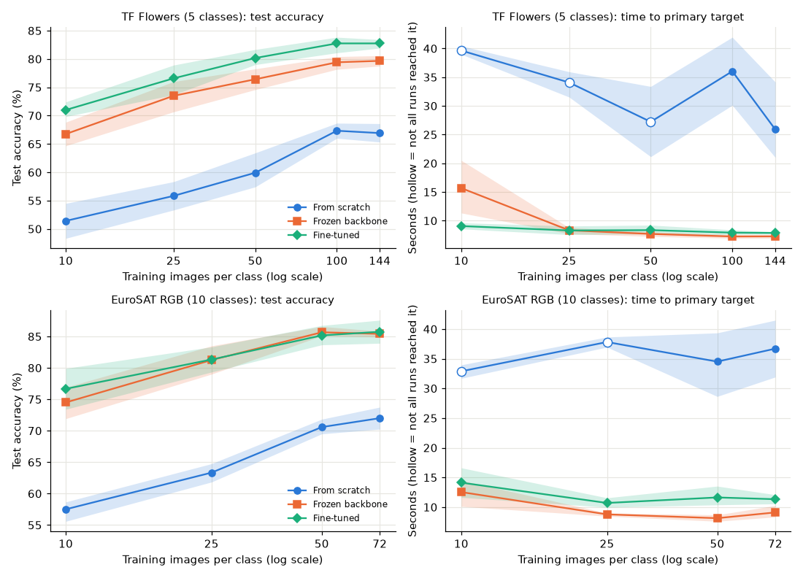
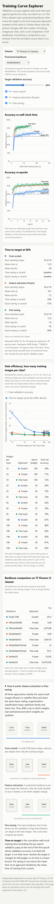
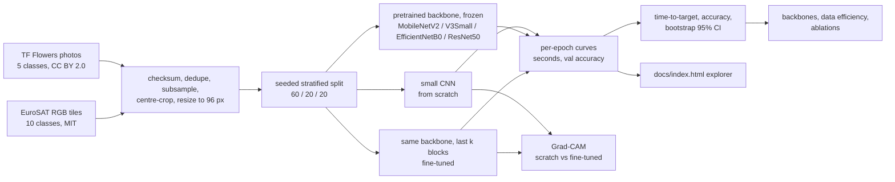
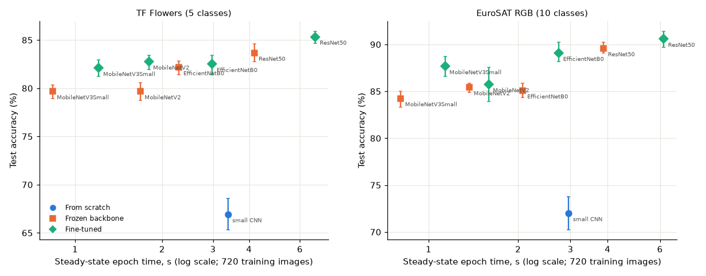
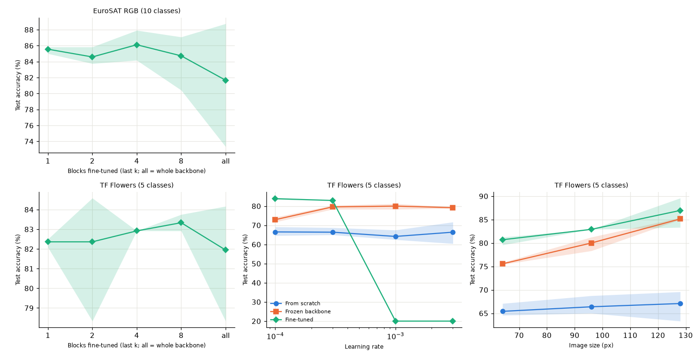
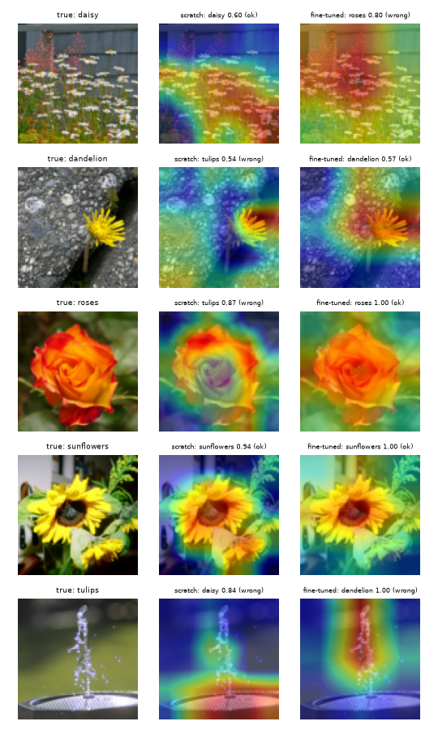

# Transfer Learning for Computer Vision: when and why does it save training time and data?

[](https://creativecommons.org/licenses/by-nc-nd/4.0/)

## Summary

Independent CPU measurements on two public image datasets (TF Flowers, EuroSAT RGB), four ImageNet backbones and training sets of 10 to 144 images per class. All numbers below are from committed runs (`results/`, `docs/runs/`); intervals are 95% percentile bootstraps over seeds.

| Question | What was measured | Result |
|---|---|---|
| Does transfer learning reach a target faster than training from scratch? | Time to 95% of the scratch CNN's final validation accuracy, MobileNetV2, 5 seeds | Yes: 70% (frozen) and 68% (fine-tuned) less time on flowers; 76% and 69% on EuroSAT |
| Does it generalise across datasets and backbones? | 4 backbones x 2 datasets, same pipeline and seeds | Yes: every backbone reduced the time, by 45% (EfficientNetB0 fine-tuned, flowers) to 76% (MobileNetV2 frozen, EuroSAT) |
| Does it help when there is little data? | 10, 25, 50, 100, all images per class | Strongly: on flowers a fine-tuned MobileNetV2 trained on 10 images per class (71.0% test accuracy) beat the scratch CNN trained on all 144 (66.9%); the fine-tuned model's accuracy advantage is +15 to +21 points at every size |
| When does it not help? | Easy targets, heavy backbones, high learning rates | ResNet50 and EfficientNetB0 fine-tuned need 22% to 24% more seconds than scratch to reach 60% on EuroSAT (72% fewer epochs, but epoch 1 alone costs more than the scratch CNN's whole run to that target); fine-tuning at learning rate 1e-3 collapses to chance |
| Which choices matter? | Fine-tune depth, learning rate, image size (3 seeds each) | Fine-tuning 1 to 4 blocks is as accurate as 8 or all and needs 2 to 4x less time to the target; learning rate is critical for fine-tuning; larger images help pretrained models (+9.5 points frozen, 64 to 128 px) but not the scratch CNN |
| Do the models look at the flower? | Grad-CAM + masking check, scratch vs fine-tuned | Masking the Grad-CAM region hurts the prediction more than masking a random region for both models; the models do not differ significantly in this check |



## Overview

How much training time and how much labelled data does transfer learning save compared with training from scratch, and when does the saving disappear? The repository measures this on a CPU with a defined metric (time-to-target), identical protocols across approaches, several seeds and bootstrap intervals, and ships an interactive explorer of every recorded training curve.

**Independent experiment on public data. The 30% reduction in training time on the CV is a reported result from an earlier project and is not reproduced here.** The original project's data and code are not available, and nothing in this repository claims to be that result.

## Demo

Open `docs/index.html` in a browser (double-click it; no server, no network). Choose a dataset and a backbone, move the target-accuracy slider and the time-to-target table and the curves update live from the recorded runs. Below that: a data-efficiency chart (accuracy or time-to-target against images per class) and a backbone cost table. A "How it works" panel explains feature extraction versus fine-tuning. Local only; nothing is deployed.

| Desktop (1280 px) | Phone (390 px) |
|---|---|
|  |  |

(`docs/screenshots/explorer-1280.png` and `explorer-390.png` show the first version of the explorer, flowers and MobileNetV2 only.)

## Problem statement

For a small image-classification task on a CPU: for the same target accuracy, how much training time does transfer learning save compared with training from scratch; how does that change with the dataset, the pretrained backbone and the amount of training data; and which design choices (how many layers to fine-tune, learning rate, image size) matter?

The metric is unchanged from the first version:

- **Time-to-target**: the cumulative wall-clock training time (and the number of epochs) at the end of the first epoch whose validation accuracy is at least the target. The timer is monotonic and includes the per-epoch validation pass.
- **Primary target** (per dataset): 95% of the from-scratch CNN's final validation accuracy in the backbone experiment (flowers 65.2%, EuroSAT 70.3%). Fixed targets of 50%, 60% and 80% are reported too, because the saving depends on the target.
- **Relative reduction vs scratch**: `1 - mean(time-to-target of approach) / mean(time-to-target of scratch)`.
- A run that never reaches the target is charged its full budget, so its time is a lower bound (shown as `>=`).

## Approach



- **From scratch**: a 4-block CNN with batch norm (241,829 parameters), random initialisation.
- **Frozen (feature extraction)**: an ImageNet-pretrained backbone, frozen, only the classification head trains.
- **Fine-tuned**: the same backbone with its last `k` blocks (default `k = 4`) also trained; batch-norm layers stay frozen. For MobileNetV2 this is exactly the original setting (`block_13_expand` onwards; the legacy parameter counts are asserted in `tests/test_models.py`).
- **Backbones**: MobileNetV2 (2.3 M parameters), MobileNetV3Small (0.9 M), EfficientNetB0 (4.1 M), ResNet50 (23.6 M), all with ImageNet weights from `keras.applications` and their own input scaling.
- **Identical for all runs**: augmentation (flip, small rotation and zoom), head, Adam, batch size 32, loss, 30-epoch budget, seeds. The learning rate is the one per-approach setting: chosen per (dataset, backbone, approach) on a separate pilot seed (100) from {1e-4, 3e-4, 1e-3}; see `docs/runs/2026-10-15-extension.md` and `configs/lr_choices.json`.
- **Timing**: `time.perf_counter()` around `model.fit` only. Download and caching, model construction, weight download and the final test evaluation are excluded; graph tracing in epoch 1 is included for every approach. Each run also records how much CPU the rest of the machine used during the fit (`bg_cpu_fraction`, see Limitations).

## Data

| Item | TF Flowers | EuroSAT RGB |
|---|---|---|
| Source | https://storage.googleapis.com/download.tensorflow.org/example_images/flower_photos.tgz | https://zenodo.org/records/7711810 (`EuroSAT_RGB.zip`) |
| Licence | CC BY 2.0 per photo, attribution in `THIRD_PARTY_NOTICES.md` | MIT (Zenodo record and project repository); Sentinel-2 imagery is open Copernicus data |
| Checksum | SHA-256 verified at download | SHA-256 and the published MD5 verified at download |
| Classes | 5 (daisy, dandelion, roses, sunflowers, tulips) | 10 (land-use classes, for example Forest, Residential, SeaLake) |
| Subset | 3 duplicate files removed, then 240 per class (1,200) | 120 per class (1,200), no duplicates found |
| Split | stratified 60/20/20, seed 2026: 720 / 240 / 240 | same: 720 / 240 / 240 (72 / 24 / 24 per class) |
| Image size | centre-cropped, resized to 96 x 96 | 64 x 64 tiles up-scaled to 96 x 96 |
| Leakage checks | split indices are disjoint (unit-tested); no pixel-identical image appears in two splits (asserted when the cache is built) | same |
| Privacy | photographs of flowers; no personal data | satellite tiles; no personal data |

Both datasets are downloaded at run time into `data/` (git-ignored) and never committed. `results/split_manifest.json` and `results/split_manifest_eurosat.json` list file names only. The flowers split is identical to the one used in the 2026-10-14 run (verified by comparing the file lists).

## Results

### History: the original headline and its re-measurement

The first version (run 2026-10-14, 10 seeds, flowers, MobileNetV2) is kept unchanged; the new code path was run again on seeds 0 to 4 as a consistency check.

| Run | Seeds | Primary target | Scratch time | Frozen: time (reduction) | Fine-tuned: time (reduction) | Test accuracy scratch / frozen / fine-tuned | Status |
|---|---|---|---|---|---|---|---|
| 2026-10-14, original code | 10 | 64.6% | 32.0 s | 11.4 s (64%, 55 to 71) | 13.3 s (58%, 48 to 66) | 68.0 / 80.3 / 82.8% | Verified (original run, `docs/runs/2026-10-14-experiment.md`) |
| 2026-10-14/15, new code (`backbones_flowers`) | 5 | 65.2% | 33.6 s | 10.0 s (70%, 49 to 82) | 10.6 s (68%, 49 to 79) | 66.9 / 79.7 / 82.7% | Verified (this log) |

The two runs agree within their intervals; the larger reductions in the second row come from five seeds, a slightly different target and run-to-run timing noise on a shared machine, not from a changed method. Full original tables (targets 60% to 90%, final accuracy at 30 epochs) are in `results/summary.md` and `docs/runs/2026-10-14-experiment.md`.

### 1. Backbones and datasets (5 seeds, all training images, 30 epochs)

Steady epoch = median epoch time without epoch 1. Test accuracy is on the 240 held-out images (differences below roughly 2 to 3 points are within noise). Time reduction is at the primary target; full tables with confidence intervals, other targets and trainable-parameter counts: `results/summary_backbones.md`.



TF Flowers (scratch CNN: 66.9% test accuracy, 33.6 s to the target, 3.4 s per steady epoch):

| Backbone (total parameters) | Frozen: test acc / time reduction / steady epoch | Fine-tuned: test acc / time reduction / steady epoch |
|---|---|---|
| MobileNetV2 (2.3 M) | 79.7% / 70% (49 to 82) / 1.7 s | 82.7% / 68% (49 to 79) / 1.8 s |
| MobileNetV3Small (0.9 M) | 79.7% / 71% (57 to 79) / 0.8 s | 82.1% / 67% (50 to 76) / 1.2 s |
| EfficientNetB0 (4.1 M) | 82.2% / 53% (29 to 67) / 2.3 s | 82.5% / 45% (18 to 61) / 3.0 s |
| ResNet50 (23.6 M) | 83.7% / 58% (36 to 72) / 4.2 s | 85.3% / 47% (21 to 62) / 6.8 s |

EuroSAT RGB (scratch CNN: 72.0% test accuracy, 35.2 s to the target, 3.0 s per steady epoch):

| Backbone (total parameters) | Frozen: test acc / time reduction / steady epoch | Fine-tuned: test acc / time reduction / steady epoch |
|---|---|---|
| MobileNetV2 (2.3 M) | 85.4% / 76% (71 to 80) / 1.4 s | 85.7% / 69% (62 to 74) / 1.6 s |
| MobileNetV3Small (0.9 M) | 84.3% / 75% (70 to 80) / 0.8 s | 87.7% / 64% (56 to 70) / 1.1 s |
| EfficientNetB0 (4.1 M) | 85.1% / 56% (46 to 63) / 2.1 s | 89.1% / 46% (35 to 56) / 2.7 s |
| ResNet50 (23.6 M) | 89.6% / 66% (59 to 72) / 3.9 s | 90.6% / 53% (43 to 61) / 6.2 s |

What the tables show: all pretrained models beat the scratch CNN in test accuracy by 12 to 19 points and reach the target in 1 to 4 epochs instead of 8 to 11. Bigger backbones are more accurate (ResNet50 best on both datasets) but cost more per epoch, so their time saving is smaller and their intervals wider; the cheap MobileNets give the largest time saving. Fine-tuning gains 0 to 4 points over a frozen backbone (+4.0 for EfficientNetB0 and +3.4 for MobileNetV3Small on EuroSAT, +3.0 for MobileNetV2 on flowers; within noise elsewhere) and always costs more time to reach the target.

### 2. The saving depends on the target

| Target | Dataset | Frozen MobileNetV2 | Fine-tuned ResNet50 | Fine-tuned EfficientNetB0 |
|---|---|---|---|---|
| 60% | flowers | 32% (-24 to 61, not significant) | -33% (-109 to 15, not significant) | -37% (-117 to 13, not significant) |
| 60% | EuroSAT | 48% (43 to 53) | **-22% (-36 to -12): slower than scratch** | **-24% (-37 to -13): slower than scratch** |
| 80% | flowers | >= 80% (72 to 87), scratch never reached it | >= 80% (76 to 84) | >= 82% (77 to 86) |
| 80% | EuroSAT | >= 89% (87 to 90), scratch never reached it | >= 82% (81 to 83) | >= 78% (77 to 80) |

At an easy target the pretrained models need one epoch (about 12 to 17 s for the heavy backbones, mostly graph tracing and the first expensive epoch), while the small scratch CNN needs 2 to 4 cheap epochs. Per epoch the pretrained models mostly still win (at the 60% target epoch reductions are 28% to 72% on EuroSAT, and 46% to 62% on flowers except frozen MobileNetV3Small, -15% and not significant; `results/summary_backbones.md`), but seconds do not.

### 3. Data efficiency (MobileNetV2, 5 seeds, training images per class vary)

Validation and test sets are fixed; the epoch budget grows for tiny sets so every run gets at least 200 optimiser steps (n=10 on flowers: 100 epochs). Test accuracy, % (95% CI); full tables with time-to-target: `results/summary_data_efficiency.md`.

| Images per class | Flowers: scratch | frozen | fine-tuned | EuroSAT: scratch | frozen | fine-tuned |
|---|---|---|---|---|---|---|
| 10 | 51.4 (48.3 to 54.5) | 66.7 (64.7 to 68.8) | 71.0 (69.8 to 72.4) | 57.5 (55.6 to 58.7) | 74.5 (71.9 to 76.9) | 76.7 (73.4 to 79.9) |
| 25 | 55.8 (53.3 to 58.3) | 73.5 (70.7 to 76.0) | 76.6 (73.7 to 78.9) | 63.3 (61.8 to 64.8) | 81.2 (79.0 to 83.5) | 81.3 (79.3 to 83.3) |
| 50 | 59.9 (57.4 to 63.4) | 76.4 (74.6 to 78.3) | 80.2 (79.0 to 81.7) | 70.6 (69.5 to 71.8) | 85.7 (85.1 to 86.6) | 85.2 (83.7 to 86.7) |
| 100 | 67.3 (66.0 to 68.7) | 79.4 (78.2 to 80.4) | 82.7 (81.1 to 83.8) | n/a (72 available) | | |
| all (144 flowers, 72 EuroSAT) | 66.9 (65.3 to 68.6) | 79.7 (78.8 to 80.6) | 82.7 (81.9 to 83.4) | 72.0 (70.2 to 73.8) | 85.4 (84.9 to 85.8) | 85.7 (83.9 to 87.6) |

- The accuracy advantage of transfer learning is largest with the least data: +15 to +21 points on flowers and +17 to +19 on EuroSAT at 10 to 25 images per class, shrinking to +13 to +16 with all images. With these data sizes the gap narrows but does not close.
- Flowers: the fine-tuned model with 10 images per class (71.0%) is above the scratch CNN with 144 (66.9%), intervals do not overlap. EuroSAT: frozen and fine-tuned with 10 images per class (74.5%, 76.7%) are at or above scratch with 72 (72.0%); intervals overlap, so read it as "comparable or better with seven times less data".
- Time-to-target: the scratch CNN did not reach the primary target in any of 5 runs with 10 images per class (flowers and EuroSAT) and in 4 of 5 runs with 25 per class; both pretrained approaches reached it in all runs at every size. At a lenient 50% target the time saving is only 6% to 37% (for fine-tuned EuroSAT with 50 images per class the interval includes zero).
- Validation passes are part of the measured time and the validation set (240 images) is larger than the smallest training sets, so small sets are not proportionally faster in seconds.



### 4. Ablations (MobileNetV2, 3 seeds each: wide intervals, read only large effects)

Full tables with intervals: `results/summary_ablations.md`.

- **Fine-tune depth (last k blocks; k = 1, 2, 4, 8, all).** Test accuracy is flat within noise on both datasets (flowers 82.4, 82.4, 82.9, 83.3, 81.9%; EuroSAT 85.6, 84.6, 86.1, 84.7, 81.7%), while the time to the primary target grows from 7.5 s (k=1) to 18.5 s (all) on flowers and from 6.1 s to 24.1 s on EuroSAT. Unfreezing the whole backbone was the slowest and, on EuroSAT, the least stable setting.
- **Learning rate (1e-4, 3e-4, 1e-3, 3e-3), flowers.** The scratch CNN is insensitive (64.2% to 66.5% test accuracy). The frozen backbone is best at 3e-4 to 1e-3 (72.9% at 1e-4) and reaches the target fastest at 3e-3. Fine-tuning trains at 1e-4 and 3e-4 (83.9%, 82.9%) but **collapses to chance accuracy (20.0%, 0 of 3 seeds reaching any target) at 1e-3 and 3e-3**, the failure seen in the original pilot.
- **Image size (64, 96, 128 px), flowers.** Pretrained models gain from resolution: frozen 75.6, 80.0, 85.1% and fine-tuned 80.7, 82.9, 86.9% test accuracy, while the scratch CNN barely moves (65.4, 66.4, 67.1%) and pays for it in time (12.9 s, 22.7 s, 42.7 s to the target).

### 5. Explainability: Grad-CAM, scratch vs fine-tuned



One scratch CNN (65.4% test accuracy) and one fine-tuned MobileNetV2 (82.9%), both seed 0. One test image per class was chosen with a seeded random draw, not picked for how it looks; the figure includes wrong predictions. Warm colours mark the last-layer features that most increased the predicted class score.

Masking check on all 240 test images (`results/gradcam/gradcam_summary.json`): greying out the 20% of pixels Grad-CAM rates highest lowered the predicted-class probability of correctly classified images by 19.5 points (scratch; 95% CI 16.3 to 22.9) and 23.7 points (fine-tuned; 18.6 to 28.9), against 8.2 (5.5 to 11.0) and 8.3 (5.3 to 11.7) points when a random 20% was greyed out (control maps at the same resolution).

Plain-language reading:
- For both models the highlighted region matters to the prediction more than a random region of the same size does (differences +11.3 and +15.4 points, 95% intervals exclude zero). So the heat maps are not decoration.
- On the five examples shown the fine-tuned model is right on 3 and the scratch CNN on 2. On the rose the fine-tuned model is correct with probability 1.00 while the scratch CNN predicts tulips (0.87); on the sunflower both are right (1.00 and 0.94). The scratch CNN's maps are more scattered (the daisy field, the gravel around the dandelion). The fine-tuned model is not always right for the right reasons either: on the daisy field it is confidently wrong (roses, 0.80), with its map on the red flowers in the background.
- The two models do not differ significantly in this check (the intervals of the drops overlap), so this work does not show that fine-tuned models "look at better places"; it shows they are more accurate and more confident.

Limits: two models from one seed; the maps are coarse (6 x 6 cells for the scratch CNN, 3 x 3 for MobileNetV2 at 96 px) and are upsampled; Grad-CAM shows where the classifier's last features were active, not a causal explanation; masking with grey pixels creates images the models have not seen; flowers sometimes occur together with typical backgrounds, so "background" evidence can be legitimate; one image (tulips) shows a fountain, an example of label noise that no model can be right about.

### 6. Reading the results together: when does transfer learning not help?

Grounded in the tables above, and limited to this setting (small images, small training sets, CPU, ImageNet-pretrained backbones, a modest from-scratch baseline):

1. **When the target is easy and the backbone is heavy.** At 60% validation accuracy on EuroSAT, fine-tuned ResNet50 and EfficientNetB0 took 22% and 24% longer than the scratch CNN, although they needed 72% fewer epochs: epoch 1 alone costs more than the scratch CNN's whole run to that target. On flowers the same comparison is not significantly different from zero. The saving in seconds needs a target the scratch model reaches slowly or never (80%: at least 78% to 89% saved).
2. **When extra capacity is not needed.** Fine-tuning gained at most 4 accuracy points over a frozen backbone (nothing beyond noise for several backbone and dataset pairs) and always took longer to reach the target; unfreezing more than 1 to 4 blocks added cost without accuracy. A frozen backbone is the cheaper default.
3. **When the learning rate is wrong.** Fine-tuning at 1e-3 or higher destroyed the pretrained features (chance accuracy in 3 of 3 seeds); the scratch CNN tolerated the same rates.
4. **When data is plentiful.** The accuracy gap shrank from about +20 to about +13 to +16 points as training images per class grew from 10 to the full 144 (flowers) or 72 (EuroSAT); the gap was still large at the sizes tested, so this study does not show the gap closing. More data would be needed to see where, if anywhere, the gap closes.
5. **When the target domain is far from ImageNet.** EuroSAT (aerial tiles) still benefited in every comparison, with the largest gains from the larger backbones (ResNet50 +17.6 points frozen and +18.6 fine-tuned over scratch), so a domain gap did not remove the benefit here; whether it does for more distant domains (medical, spectral) is not tested.
6. **When the comparison is not fair to the baseline.** The scratch CNN is one small, lightly tuned model (learning rate from a 3-value pilot; at the lower grid edge on EuroSAT). A stronger from-scratch model would narrow the gap; these results are not a claim about all scratch architectures.

## Tech stack

Python 3.11, TensorFlow 2.21 / Keras 3 (CPU), NumPy, pandas, Pillow, matplotlib, pytest, ruff, mypy. The explorer is a single static HTML file with inline SVG and plain JavaScript (no libraries, no network).

## Getting started

Prerequisites: Python 3.11 (64-bit), about 1.5 GB free disk space (TensorFlow, the 229 MB flowers archive, the 95 MB EuroSAT archive and the caches), internet access for the first run. No GPU needed.

```bash
git clone https://github.com/Janeferdinant/transfer-learning-vision.git
cd transfer-learning-vision
py -3.11 -m venv .venv                       # Windows; on Linux/macOS: python3.11 -m venv .venv
.venv\Scripts\activate                       # Windows; on Linux/macOS: source .venv/bin/activate
python -m pip install -r requirements.txt    # also installs the package in editable mode
python -m pytest -q                          # expected: 69 passed
ruff check .                                 # expected: All checks passed!
```

(`pip install -r requirements.txt` already installs pytest and the package; install `ruff` and `mypy` with `pip install ruff mypy pandas-stubs` for the lint and type checks; `make check` runs all three if `make` is available. CI runs the same checks without TensorFlow: `requirements-ci.txt`.)

Quick smoke runs (a few minutes each; they download the data and weights once):

```bash
python -m tlv.experiment --seeds 0 --epochs 3 --out results/smoke           # original flowers + MobileNetV2 runner
python -m tlv.suite --suite backbones --dataset eurosat --seeds 0 --epochs 2 --backbones mobilenetv3small --out results/smoke_eurosat
python -m tlv.analysis --results results                                     # regenerates results/summary_*.json and .md
python -m tlv.plots                                                          # docs/figures/*.png
```

To reproduce the committed results (about 8 hours of wall-clock time on the machine in the run log; do not run other heavy programs, the experiments measure wall-clock time):

```bash
bash scripts/run_queue.sh      # pilot, backbones, data efficiency and ablations, resumable (or: make all-experiments)
python -m tlv.gradcam --out results/gradcam
python -m tlv.analysis && python -m tlv.plots
python -m tlv.export_viz --date <YYYY-MM-DD>       # docs/explorer-data.js for the explorer
```

The repository already contains these results, so re-running appends to `results/*/per_run.csv`; use `--out` to write elsewhere. The original 10-seed flowers run is reproduced with `python -m tlv.experiment --seeds 0 1 2 3 4 5 6 7 8 9 --epochs 30` followed by `python -m tlv.aggregate`. Timings from your machine will differ; relative reductions and epoch counts are the comparable quantities.

## Project structure

```
src/tlv/metrics.py      time-to-target, censoring, bootstrap CI, relative reduction, difference CI
src/tlv/timing.py       monotonic epoch timer (pause/resume, injectable clock)
src/tlv/config.py       run configuration and epoch-budget rule
src/tlv/grids.py        the documented experiment grids and the pilot learning-rate rule
src/tlv/blocks.py       which layers "the last k blocks" of each backbone covers
src/tlv/data.py         datasets, checksums, de-duplication, seeded subsample and stratified split
src/tlv/models.py       scratch CNN and the four pretrained backbones
src/tlv/runner.py       train one configuration, per-epoch and per-run rows
src/tlv/suite.py        run a suite (backbones, data-efficiency, depth, lr, image-size, pilot)
src/tlv/quiet.py        background-CPU measurement for timed runs
src/tlv/analysis.py     summaries with bootstrap intervals and markdown tables
src/tlv/plots.py        static figures
src/tlv/gradcam.py      Grad-CAM comparison and masking check (helpers in cam_utils.py)
src/tlv/experiment.py   original flowers/MobileNetV2 runner;  aggregate.py, export_viz.py: its summaries and the explorer data
tests/                  pytest suite (69 tests; the 8 model tests need TensorFlow, no weights are downloaded)
configs/lr_choices.json learning rates chosen on the pilot seed
scripts/run_queue.sh    the experiment queue used for these results
results/                per-run and per-epoch CSVs by suite, summary_*.json/.md, gradcam/, hardware.json, split manifests
docs/index.html         static explorer (opens from disk); docs/curves.js, docs/explorer-data.js: its data
docs/figures/           figures used in this README
docs/runs/              run logs (2026-10-14 original, 2026-10-15 extension), pilot sweeps, queue progress
.github/workflows/ci.yml  lint, type check and fast tests (never the long experiments)
```

## Real-world applications

- Deciding whether a pretrained backbone is worth using, and which one, when compute, energy or turnaround time is limited, for example on a laptop or a small shared server, or when only tens of labelled images per class exist.
- Teaching: a measured example of why pretrained features shorten training, and of how a "percent faster" claim depends on the target, the backbone's cost per epoch and fixed start-up costs.
- A template for reporting training-efficiency claims honestly: define the metric, fix the protocol, repeat over seeds, report intervals and the conditions of the machine.

## Limitations

- **Small tasks.** Two datasets, 1,200 images each, 96 px images (EuroSAT up-scaled from 64 px), 720 training images at most. Results may differ for larger images, many more classes, more data or domains far from ImageNet. Test sets have 240 images, so test-accuracy differences below roughly 2 to 3 points are within noise.
- **Shared machine, seconds are noisier than epochs.** The runs were made on a desktop that other jobs were also using. The share of CPU used by other programs during each fit is recorded (`bg_cpu_fraction`; median 0.17 to 0.35 per timed suite, 0.15 being the lowest ever seen, 10 early flowers backbone runs above 0.5; the accuracy-only pilot ran under heavier load). Repeating the backbone analysis without runs above 0.5 changes every reduction by at most 6 points (`results/summary_*_lowbg.md`). Relative reductions and epoch counts are more transferable than seconds, and seconds are not comparable between suites run at different times.
- **A modest, lightly tuned baseline.** One small scratch CNN; its learning rate came from a one-seed, 8-epoch, three-value pilot, and on EuroSAT several pilot choices sit at the lowest value of the grid (1e-4), so better rates may exist. Pretrained backbones were tuned the same way.
- **Seeds and splits.** 5 seeds for the main studies and 3 for the ablations (wide, sometimes degenerate intervals). Seeds change initialisation, shuffling and augmentation, and for the data-efficiency study also the training subset; the validation and test sets are fixed.
- **Target and budget effects.** The primary target is derived from the same runs; targets the scratch model never reaches give lower bounds, not point estimates; time-to-target has epoch granularity and includes graph tracing in epoch 1. In the data-efficiency study the epoch budget is raised for tiny sets (documented rule) and the validation set is larger than the smallest training sets.
- **Fine-tuning depth is counted in blocks**, whose size differs between backbones, so "4 blocks" is not the same fraction of every network.
- **Grad-CAM** is shown for two models of one seed, at coarse resolution, with the caveats listed above.
- **Not the CV result**: the original project's data and code are unavailable; this experiment neither reproduces nor validates the 30% figure.

## Future scope

- A stronger from-scratch baseline with a proper learning-rate and architecture search, to test how much of the gap it closes.
- Datasets further from ImageNet (medical, spectral) and larger images; a finer grid of training-set sizes beyond 144 per class to see where the accuracy gap closes.
- Vary the data split as well as the seed; repeat on a quiet or dedicated machine (or pin CPU cores) for tighter timing intervals; profile where epoch time goes (tracing, input pipeline, forward, backward).
- Learning-rate warm-up or layer-wise rates for fine-tuning, to see whether the collapse at 1e-3 can be avoided; more seeds for the ablations.
- Quantitative explanation checks across more seeds and a finer-grained CAM (earlier layers, Score-CAM).

## Credits & citation

- Photographs: the TF Flowers dataset, CC BY 2.0, with thanks to the photographers listed in the archive's `LICENSE.txt`. Satellite tiles: EuroSAT, Helber, Bischke, Dengel and Borth, IEEE JSTARS 2019 (MIT licence).
- Architectures: Sandler et al. (MobileNetV2, CVPR 2018), Howard et al. (MobileNetV3, ICCV 2019), Tan and Le (EfficientNet, ICML 2019), He et al. (ResNet, CVPR 2016). ImageNet-pretrained weights via `keras.applications`.
- Grad-CAM: Selvaraju et al., "Grad-CAM: Visual Explanations from Deep Networks via Gradient-based Localization", ICCV 2017.
- Full notices: `THIRD_PARTY_NOTICES.md`.

If you refer to this work: Ferdinant, J. R., "Transfer learning for computer vision: when and why it saves training time and data" (GitHub repository, 2026).

## License

Original work © Jane Rose Ferdinant, licensed CC BY-NC-ND 4.0. Third-party components retain their own licenses; see THIRD_PARTY_NOTICES.md.

## Author

Jane Rose Ferdinant, Assistant Professor, AI & ML.

- Portfolio: https://janeferdinant.vercel.app
- LinkedIn: https://www.linkedin.com/in/janerosenf/
